# Laporan Integrasi & Verifikasi — Phase 3 (`sipahal-api` & `apk_sipahal`)

- **Penguji:** Tim QA / Pengembang SIPAHAL
- **Lingkungan:** Flutter (`apk_sipahal`) & backend Laravel (`http://10.0.2.2:8000/api`)
- **Tanggal uji:** 19 November 2026
- **Data uji:** Akun demo Warga (`warga@sipahal.com` / `warga123`), Admin DLH (`admin@sipahal.com` / `admin123`), Petugas DLH (`petugas@sipahal.com` / `petugas123`), laporan utama `SPH-4OI3PX`, dan laporan uji penolakan `SPH-BAEGFV`
- **Keterangan status:** ✅ Pass, ❌ Fail, ⚠️ Pass dengan catatan

## 1. Identitas Proyek & Pembagian Tim
- **Proyek**: Sistem Pelaporan SIPAHAL (`sipahal-api` sebagai backend REST API Laravel dan `apk_sipahal` sebagai aplikasi mobile Flutter).
- **Repository**:
  - Backend: `sipahal-api`
  - Frontend Mobile: `apk_sipahal`
- **Pembagian Peran Tim (4 Orang)**:
  - **Anggota 1**: Backend Core & Status Workflow (`ReportController` dan alur status laporan).
  - **Anggota 2**: API Client, Auth & Security (komunikasi REST API `10.0.2.2:8000/api`, peran pengguna, dan keamanan data).
  - **Anggota 3**: UI State, Async, Loading & Error Handling (tampilan Warga, Admin, Petugas, dan detail laporan).
  - **Anggota 4**: Local Persistence/Cache, Mobile Capability & Integration Evidence (cache lokal, GPS/peta/navigasi, dan dokumentasi bukti).

## 2. Integrasi REST API & Alur Status
- Aplikasi Flutter (`apk_sipahal`) terhubung ke backend Laravel (`sipahal-api`) melalui REST API (`http://10.0.2.2:8000/api`) menggunakan klien HTTP dan pemetaan model data.
- Siklus status laporan berjalan dari pembuatan laporan (`Menunggu`) hingga verifikasi (`Diverifikasi`) atau penolakan (`Ditolak`), penugasan ke petugas (`Ditugaskan`), mulai pengerjaan (`Dikerjakan`), dan penyelesaian laporan (`Selesai`), serta terpantau pada riwayat status dan notifikasi.

## 3. Async, State, Loading & Error Handling
- Setiap permintaan jaringan dan aksi pengguna (memuat daftar, membuat/memperbarui laporan, mencari lokasi, atau mengambil posisi) menangani status *loading*, validasi input form (lokasi wajib diisi dan deskripsi minimal 10 karakter), kondisi sukses/kosong, serta dialog/notifikasi status.

## 4. Local Persistence / Cache & Mobile Capability
- **Local Persistence / Cache**: Data laporan dan sesi/cache lokal disimpan menggunakan penyimpanan lokal (`SharedPreferences`) agar data tetap dapat ditampilkan/di-*fallback* saat pemuatan ulang atau gangguan koneksi.
- **Mobile Capability**:
  - Pengambilan lokasi perangkat (GPS) dan pemilihan titik lokasi pada peta.
  - Pencarian lokasi berbasis teks (*geocoding*) dan kontrol *zoom* (`+`/`-`) pada peta.
  - Navigasi peta eksternal dengan *fallback* tautan web OpenStreetMap agar tetap berjalan di emulator serta dukungan lampiran foto.

## 5. Auth & Security Basics
- Aplikasi membedakan akses berdasarkan peran pengguna (`warga`, `petugas`, `admin`) melalui halaman pemilihan jenis akun dan akun demo masing-masing peran, serta mengelola token/sesi autentikasi ke API.
- Data sensitif dijaga agar tidak disimpan sembarangan di penyimpanan lokal dan disesuaikan dengan kebutuhan keamanan lingkungan pengembangan saat ini.

## 6. Verifikasi Acceptance Criteria & Bukti (`evidence/`)

### A. Pembuka, Pemilihan Peran & Login

| ID | Judul | Langkah Pengujian | Hasil Diharapkan | Hasil Nyata | Status |
|----|-------|-------------------|------------------|-------------|--------|
| TC-01 | Halaman awal & akses cepat SIPAHAL | 1. Buka aplikasi SIPAHAL 2. Periksa menu akses cepat | Tampil layar utama SIPAHAL beserta tombol *Lapor dengan GPS*, *Peta titik sampah liar*, *Pantau status*, *Mulai*, dan *Masuk* | Tampil layar utama SIPAHAL (`PROTOTIPE · 2026`) beserta seluruh tombol akses cepat. 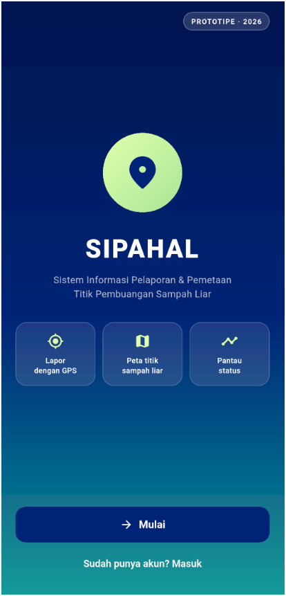 | ✅ |
| TC-02 | Pemilihan jenis akun / peran | 1. Dari menu awal, tekan *Mulai* atau *Masuk* | Tersedia pilihan peran *Warga / Pelapor*, *Petugas DLH*, dan *Admin DLH* | Ketiga pilihan peran tampil jelas sesuai alurnya. 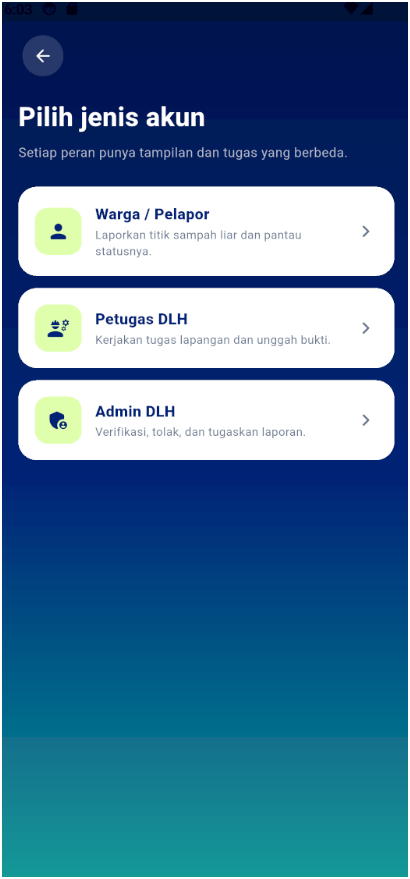 | ✅ |
| TC-03 | Login peran Warga / Pelapor | 1. Pilih *Warga / Pelapor* 2. Ketuk *Isi akun demo* (`warga@sipahal.com` / `warga123`) 3. Tekan *Masuk* | Form login terisi akun demo warga dengan opsi pengisian cepat akun demo | Form login terisi akun demo (`warga@sipahal.com` / `warga123`) dengan tombol pengisian cepat akun demo. 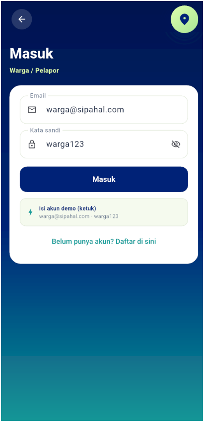 | ✅ |

### B. Alur Warga: Peta, Validasi, Buat Laporan & Riwayat

| ID | Judul | Langkah Pengujian | Hasil Diharapkan | Hasil Nyata | Status |
|----|-------|-------------------|------------------|-------------|--------|
| TC-04 | Kondisi peta sebelum laporan baru | 1. Masuk sebagai Warga 2. Buka halaman peta | Peta menampilkan ringkasan laporan, filter status, kontrol zoom `+`/`-`, GPS, dan tombol *Buat Laporan* | Peta menampilkan `3 laporan · 1 masih aktif` (`3 milikmu`), filter status, kontrol zoom `+`/`-`, GPS, dan tombol *Buat Laporan*. 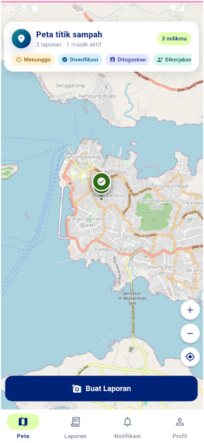 | ✅ |
| TC-05 | Validasi lokasi kosong pada form | 1. Buka form *Buat Laporan* 2. Biarkan lokasi kosong lalu coba kirim | Muncul pesan peringatan lokasi wajib diisi | Muncul pesan peringatan *"Lokasi wajib diisi. Ambil GPS atau pilih titik di peta."* saat lokasi belum ditentukan. 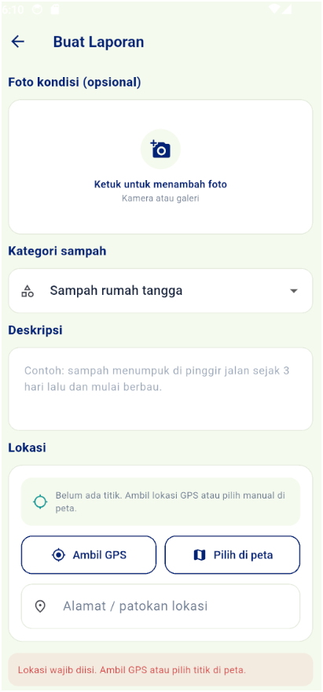 | ✅ |
| TC-06 | Validasi panjang deskripsi | 1. Isi lokasi (`0.918598, 104.446700`) 2. Isi deskripsi pendek (`< 10` karakter) lalu coba kirim | Muncul pesan peringatan deskripsi minimal 10 karakter | Dengan titik `0.918598, 104.446700` terisi, muncul pesan *"Deskripsi minimal 10 karakter."* saat deskripsi belum memenuhi batas. 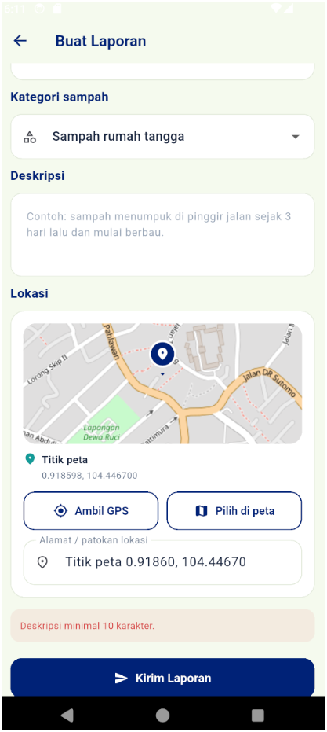 | ✅ |
| TC-07 | Pengisian form laporan lengkap | 1. Pilih kategori `Sampah plastik` 2. Isi deskripsi valid 3. Pastikan koordinat `0.918598, 104.446700` terisi | Form terisi lengkap dan siap dikirim | Kategori `Sampah plastik`, deskripsi valid, dan koordinat `0.918598, 104.446700` terisi siap dikirim. 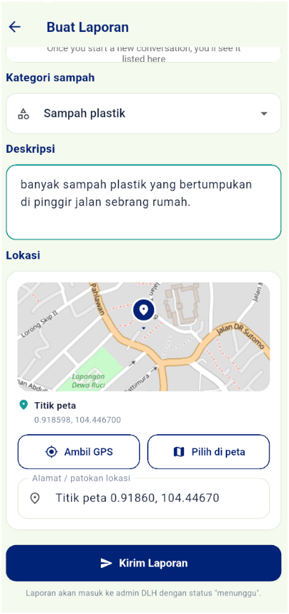 | ✅ |
| TC-08 | Pengiriman laporan & status awal | 1. Tekan *Kirim Laporan* pada form yang sudah terisi | Muncul notifikasi laporan terkirim dengan status awal `menunggu` dan jumlah laporan bertambah | Muncul notifikasi *"Laporan terkirim. Status awal: menunggu."* dan jumlah laporan naik menjadi `5 laporan · 3 masih aktif` (`5 milikmu`). 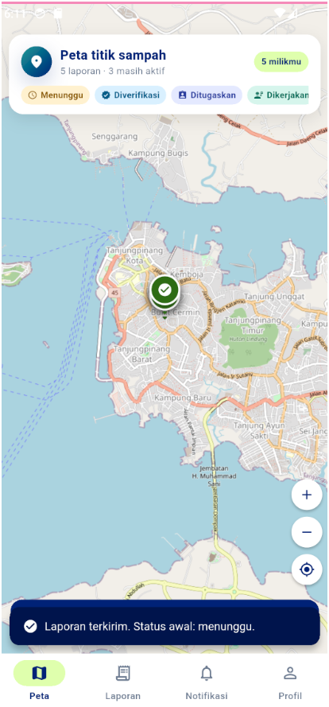 | ✅ |
| TC-09 | Detail laporan `SPH-4OI3PX` (bagian atas) | 1. Buka detail laporan `SPH-4OI3PX` | Detail menampilkan badge `Menunggu`, kategori, koordinat, dan peta lokasi | Detail `SPH-4OI3PX` menampilkan badge `Menunggu`, kategori `Sampah plastik`, koordinat `0.918598, 104.446700`, dan peta lokasi. Terdapat placeholder teks bahasa Inggris (lihat BUG-01). 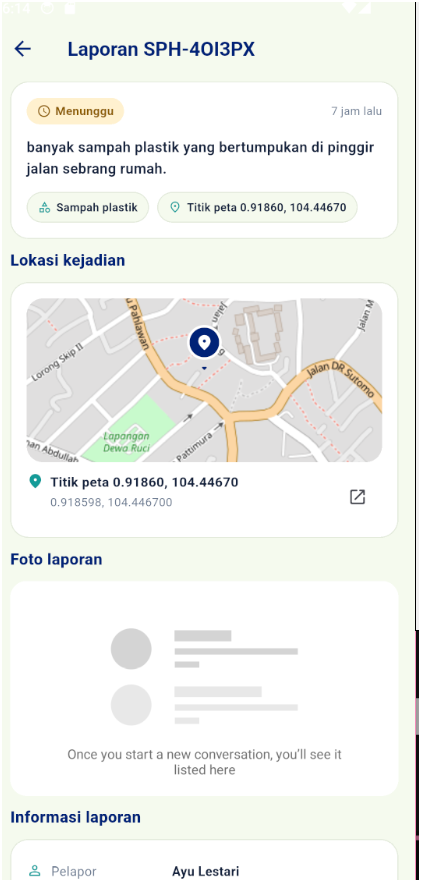 | ⚠️ |
| TC-10 | Detail laporan `SPH-4OI3PX` & riwayat status | 1. Gulir ke bagian bawah detail laporan `SPH-4OI3PX` | Menampilkan pelapor, status petugas awal, waktu, dan *Riwayat status* dengan tahap `Menunggu` aktif | Menampilkan pelapor `Ayu Lestari`, petugas `Belum ditugaskan`, waktu `19 Nov 2026 • 11:09`, dan *Riwayat status* dengan tahap `Menunggu` aktif. 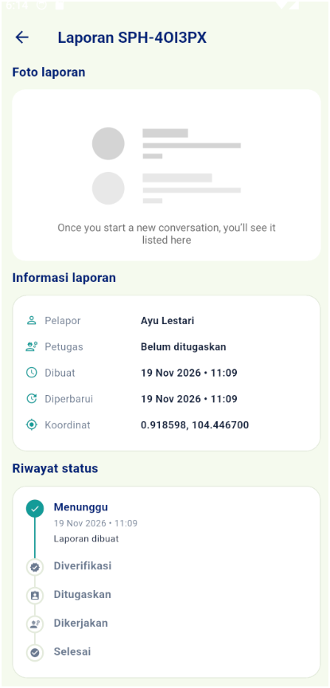 | ✅ |
| TC-11 | Profil & informasi akun Warga | 1. Buka tab *Profil* pada akun Warga | Menampilkan identitas akun, metrik laporan, status aktif, dan opsi keluar/reset demo | Menampilkan identitas `Ayu Lestari` (`warga@sipahal.com`), metrik laporan (`5` total, `2` selesai), status `Aktif`, dan opsi keluar/reset demo. Label penyimpanan tertulis `Lokal (demo)` (lihat BUG-02). 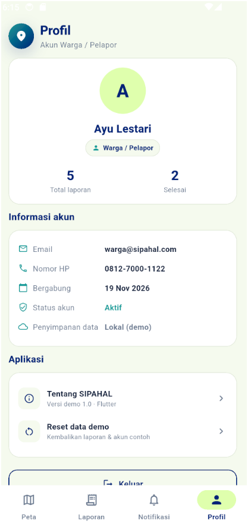 | ⚠️ |
| TC-12 | Dialog konfirmasi keluar akun | 1. Tekan tombol *Keluar* di halaman profil Warga | Muncul modal konfirmasi keluar akun dengan opsi *Batal* dan *Keluar* | Muncul modal konfirmasi *"Keluar dari akun?"* dengan opsi *Batal* dan *Keluar*. 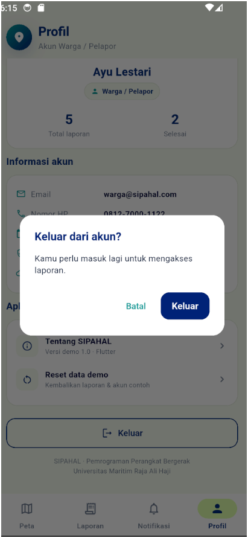 | ✅ |
| TC-13 | Riwayat notifikasi pembaruan status | 1. Buka tab *Notifikasi* pada akun Warga | Menampilkan daftar riwayat perubahan status laporan | Menampilkan daftar riwayat perubahan status (*Ditugaskan*, *Diverifikasi*, *Dikerjakan*, *Selesai*). 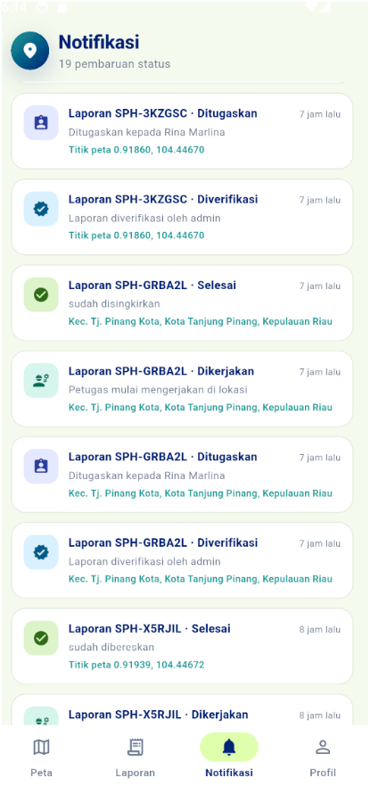 | ✅ |

### C. Alur Admin DLH: Login, Verifikasi, Penugasan & Monitoring

| ID | Judul | Langkah Pengujian | Hasil Diharapkan | Hasil Nyata | Status |
|----|-------|-------------------|------------------|-------------|--------|
| TC-14 | Login peran Admin DLH | 1. Pilih *Admin DLH* 2. Periksa form login demo (`admin@sipahal.com` / `admin123`) | Form login tampil dengan akun demo admin dan tombol pengisian cepat | Form login tampil dengan akun demo `admin@sipahal.com` / `admin123` serta tombol *Isi akun demo (ketuk)*. 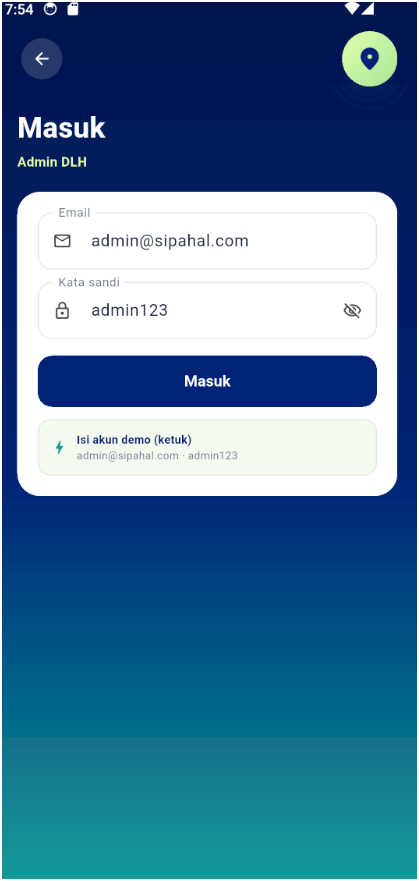 | ✅ |
| TC-15 | Dashboard ringkasan Admin DLH | 1. Masuk sebagai Admin DLH dan buka *Dashboard Admin* | Menampilkan metrik status laporan, peta sebaran titik, dan daftar *Laporan terbaru* | Menampilkan metrik status laporan, peta sebaran titik, dan daftar *Laporan terbaru* (`Dewi Anggraini · DLH`). 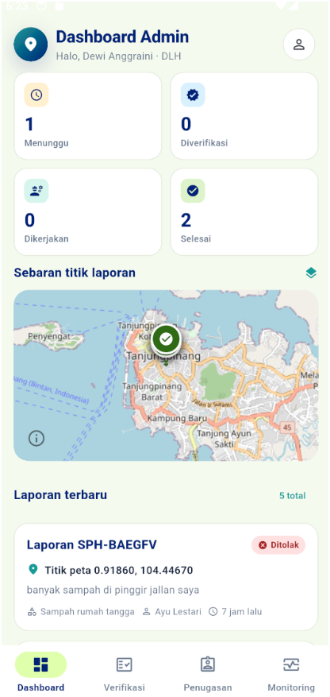 | ✅ |
| TC-16 | Antrean verifikasi laporan Admin | 1. Buka tab *Verifikasi* pada halaman Admin DLH | Menampilkan laporan berstatus `Menunggu` beserta tombol *Verifikasi* dan *Tolak* | Menampilkan `Laporan SPH-4OI3PX` berstatus `Menunggu` dengan tombol *Verifikasi* dan *Tolak*. 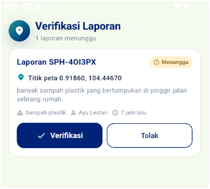 | ✅ |
| TC-17 | Dialog konfirmasi verifikasi laporan | 1. Tekan tombol *Verifikasi* pada `Laporan SPH-4OI3PX` | Muncul dialog konfirmasi perubahan status menjadi `"diverifikasi"` | Muncul dialog konfirmasi perubahan status `SPH-4OI3PX` menjadi `"diverifikasi"`. 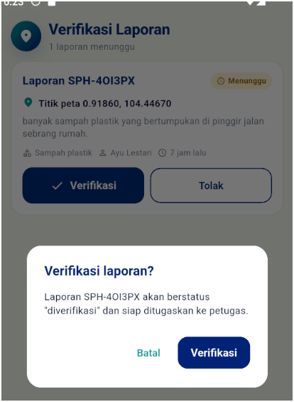 | ✅ |
| TC-18 | Hasil verifikasi laporan | 1. Konfirmasi verifikasi pada dialog yang muncul | Muncul notifikasi verifikasi sukses dan antrean menunggu berkurang | Muncul notifikasi *"Laporan SPH-4OI3PX diverifikasi."* dan antrean menunggu menjadi `0`. 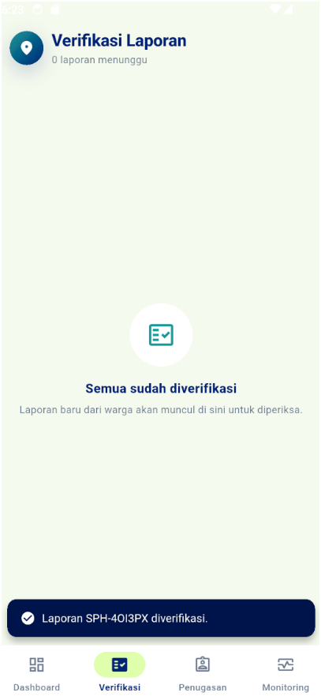 | ✅ |
| TC-19 | Daftar laporan siap ditugaskan | 1. Buka tab *Penugasan Petugas* pada halaman Admin DLH | Menampilkan laporan berstatus `Diverifikasi` dan tombol *Tugaskan* | Tab *Penugasan Petugas* menampilkan `Laporan SPH-4OI3PX` berstatus `Diverifikasi` dan tombol *Tugaskan*. 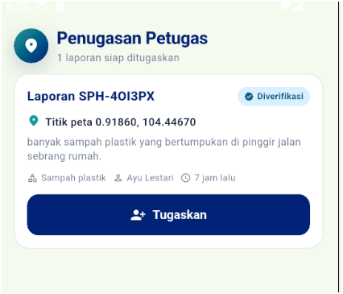 | ✅ |
| TC-20 | Pemilihan petugas penugasan | 1. Tekan tombol *Tugaskan* pada `Laporan SPH-4OI3PX` | Muncul modal *Pilih petugas* beserta daftar petugas dan tombol *Tugaskan sekarang* | Modal *Pilih petugas* menampilkan daftar petugas (`Andri Saputra`, `Rina Marlina`) dan tombol *Tugaskan sekarang*. 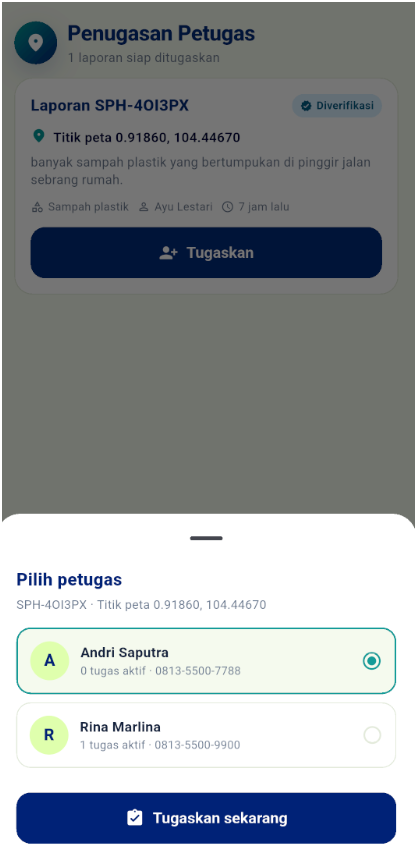 | ✅ |
| TC-21 | Konfirmasi penugasan petugas | 1. Pilih petugas lalu tekan *Tugaskan sekarang* | Muncul notifikasi penugasan sukses dan antrean siap ditugaskan berkurang | Muncul notifikasi *"Laporan ditugaskan ke petugas."* dan antrean siap ditugaskan menjadi `0`. 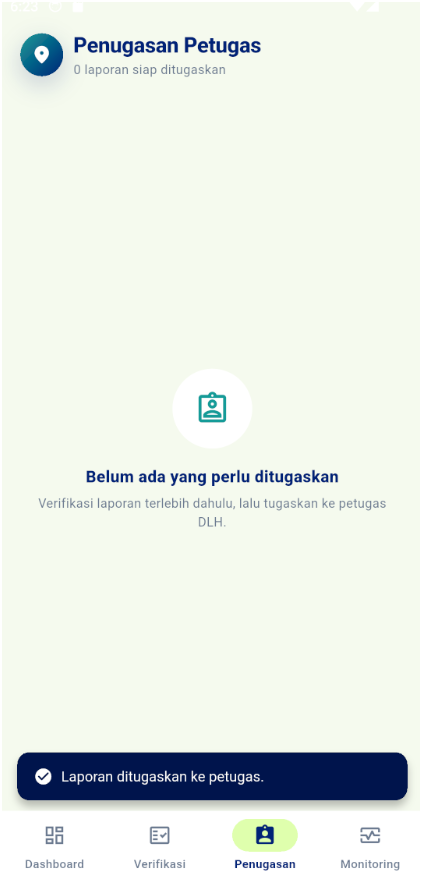 | ✅ |
| TC-22 | Detail laporan berstatus Ditugaskan (atas) | 1. Buka detail `SPH-4OI3PX` setelah ditugaskan | Menampilkan badge `Ditugaskan` beserta lokasi dan pratinjau peta | Detail `SPH-4OI3PX` menampilkan badge `Ditugaskan` beserta lokasi dan pratinjau peta. 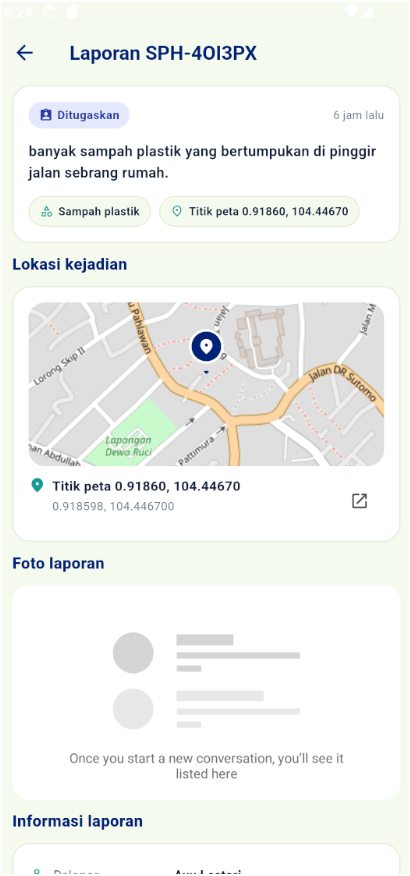 | ✅ |
| TC-23 | Detail laporan & riwayat status Ditugaskan | 1. Gulir ke bagian informasi dan riwayat status pada detail `SPH-4OI3PX` | Menampilkan nama petugas yang ditugaskan, waktu pembaruan, dan centang aktif hingga `Ditugaskan` | Menampilkan petugas `Andri Saputra`, waktu diperbarui `19 Nov 2026 • 11:24`, dan centang aktif hingga tahap `Ditugaskan`. 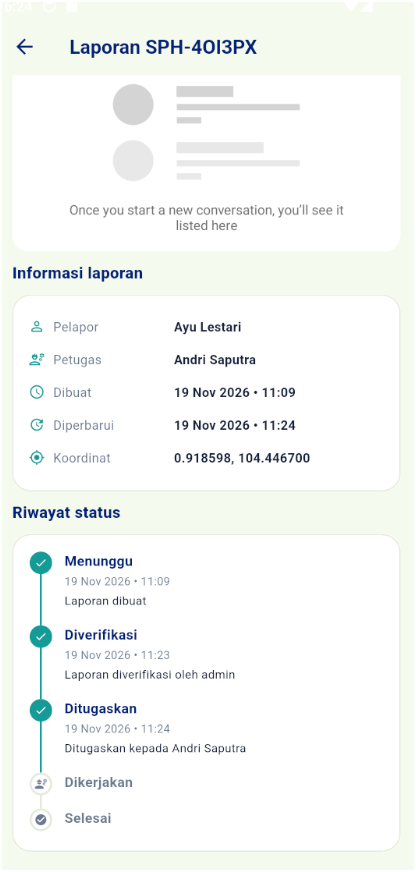 | ✅ |
| TC-24 | Monitoring laporan oleh Admin DLH | 1. Buka tab *Monitoring* pada halaman Admin DLH | Menampilkan ringkasan jumlah laporan, filter status, dan daftar laporan | Menampilkan `5 laporan · 5 ditampilkan`, filter status, dan daftar laporan termasuk `SPH-4OI3PX`. 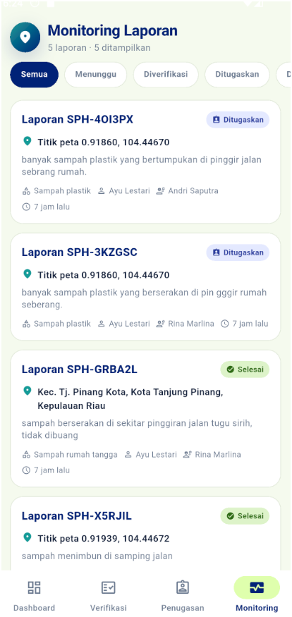 | ✅ |
| TC-25 | Profil & menu pengaturan Admin DLH | 1. Buka tab *Profil* pada halaman Admin DLH | Menampilkan informasi akun admin, metrik laporan, dan menu pengaturan | Menampilkan akun `Dewi Anggraini` (`admin@sipahal.com`), metrik laporan, dan opsi *Backup data*, *Reset data demo*, serta *Keluar*. Label penyimpanan tertulis `Lokal (demo)` (lihat BUG-02). 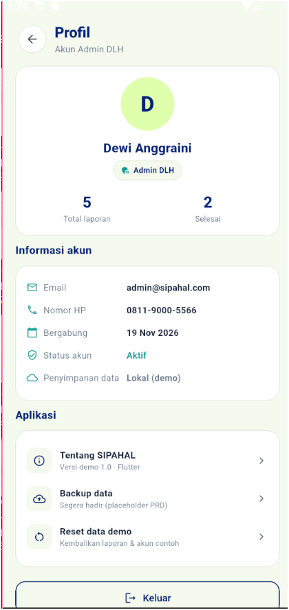 | ⚠️ |

### D. Alur Petugas DLH & Penyelesaian Laporan (`SPH-4OI3PX`)

| ID | Judul | Langkah Pengujian | Hasil Diharapkan | Hasil Nyata | Status |
|----|-------|-------------------|------------------|-------------|--------|
| TC-26 | Login peran Petugas DLH | 1. Pilih *Petugas DLH* 2. Periksa form login demo (`petugas@sipahal.com` / `petugas123`) | Form login tampil dengan akun demo petugas dan tombol pengisian cepat | Form login tampil dengan akun demo `petugas@sipahal.com` / `petugas123` serta tombol *Isi akun demo (ketuk)*. 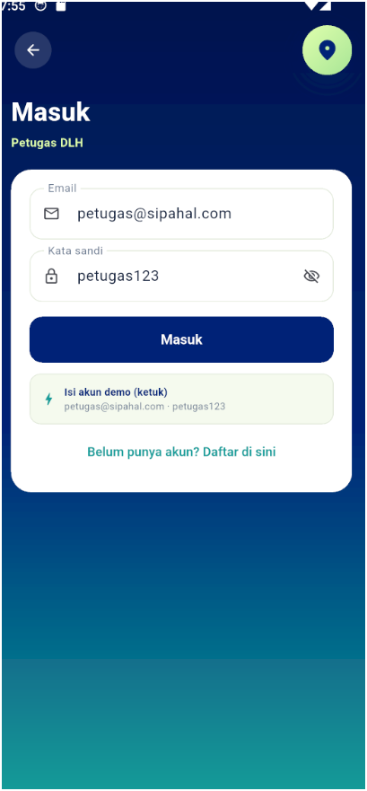 | ✅ |
| TC-27 | Daftar tugas awal Petugas DLH | 1. Masuk sebagai Petugas DLH dan buka *Daftar Tugas* | Menampilkan tugas berstatus `Ditugaskan` dan tombol *Mulai* | Menampilkan tugas `SPH-4OI3PX` berstatus `Ditugaskan` (`1 Belum dimulai`, `0 Sedang dikerjakan`) dan tombol *Mulai*. 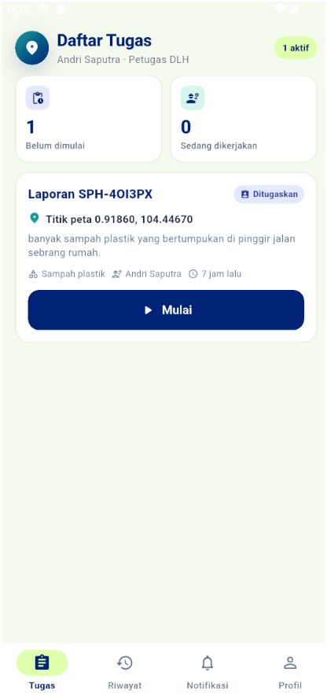 | ✅ |
| TC-28 | Dialog konfirmasi mulai tugas | 1. Tekan tombol *Mulai* pada tugas `SPH-4OI3PX` | Muncul dialog konfirmasi perubahan status menjadi `"dikerjakan"` | Muncul dialog *"Mulai tugas?"* dengan informasi status akan berubah menjadi `"dikerjakan"`. 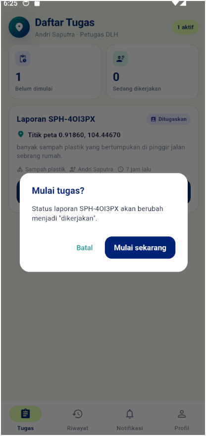 | ✅ |
| TC-29 | Tugas dimulai & status Dikerjakan | 1. Konfirmasi mulai tugas pada dialog | Muncul notifikasi tugas dimulai dan status berubah menjadi `Dikerjakan` | Muncul notifikasi *"Tugas dimulai. Status: dikerjakan."* dan status `SPH-4OI3PX` berubah menjadi `Dikerjakan`. 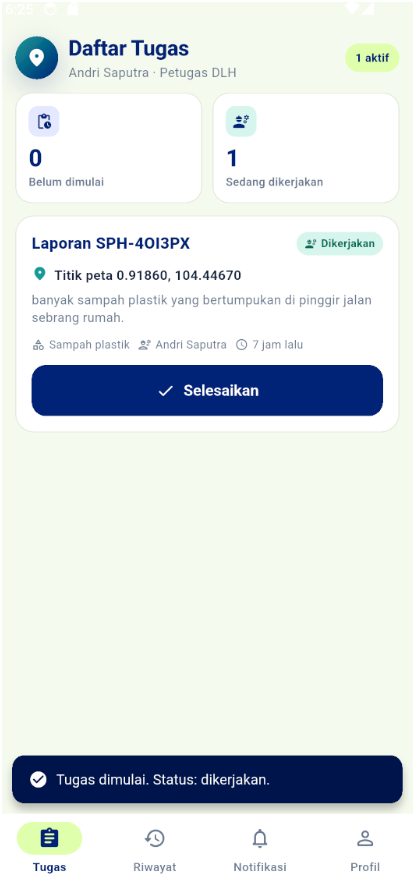 | ✅ |
| TC-30 | Modal penyelesaian tugas & catatan | 1. Tekan *Selesaikan* pada tugas `SPH-4OI3PX` 2. Isi catatan pekerjaan | *Bottom sheet* penyelesaian tampil beserta input catatan dan tombol *Tandai Selesai* | *Bottom sheet* *Selesaikan SPH-4OI3PX* terisi catatan *"sudah di kerjakan dan clear"* dan tombol *Tandai Selesai*. 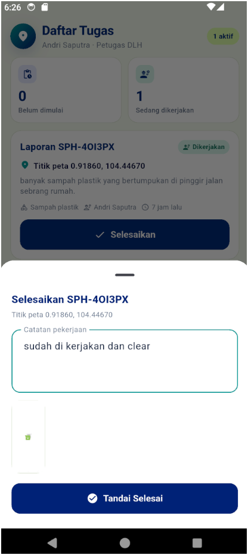 | ✅ |
| TC-31 | Konfirmasi tugas selesai & antrean kosong | 1. Tekan *Tandai Selesai* pada modal penyelesaian | Muncul notifikasi tugas selesai dan jumlah tugas aktif menjadi `0` | Muncul notifikasi *"Tugas selesai. Laporan sudah diperbarui."* dan tugas aktif menjadi `0 aktif`. 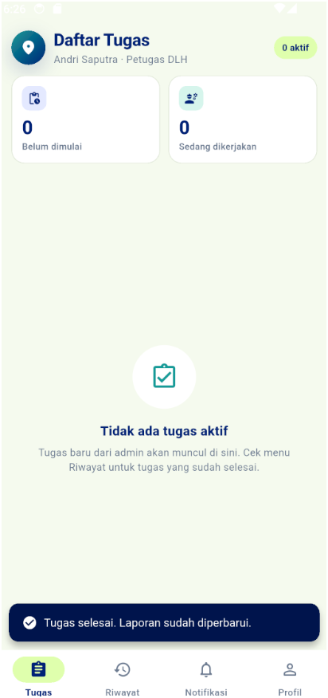 | ✅ |
| TC-32 | Riwayat tugas selesai Petugas DLH | 1. Buka tab *Riwayat Tugas* pada halaman Petugas DLH | Menampilkan tugas yang sudah selesai beserta badge `Selesai` | Tab *Riwayat Tugas* (`2 tugas selesai`) menampilkan `SPH-4OI3PX` dengan badge `Selesai`. 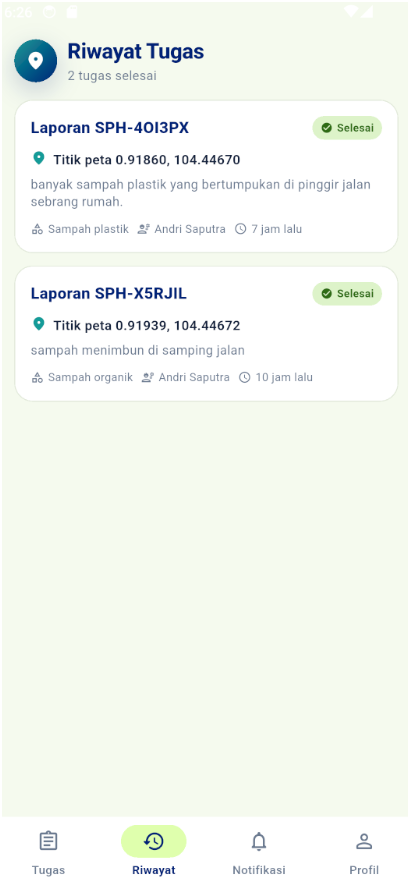 | ✅ |
| TC-33 | Notifikasi & riwayat pembaruan Petugas DLH | 1. Buka tab *Notifikasi* pada halaman Petugas DLH | Menampilkan daftar pembaruan status laporan sisi petugas | Tab *Notifikasi* (`14 pembaruan status`) mencatat tahapan status laporan hingga penugasan petugas. 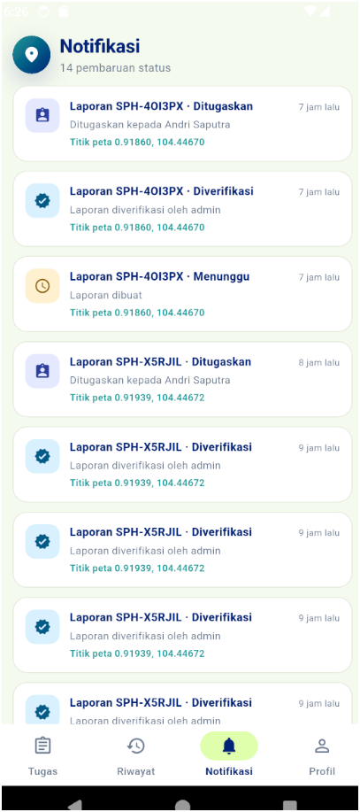 | ✅ |
| TC-34 | Detail laporan selesai (bagian atas) | 1. Buka detail laporan `SPH-4OI3PX` yang sudah selesai (sisi petugas) | Menampilkan badge `Selesai`, lokasi peta, dan catatan awal petugas | Detail `SPH-4OI3PX` menampilkan badge `Selesai`, lokasi peta, dan catatan awal petugas. Terdapat placeholder teks bahasa Inggris (lihat BUG-01). 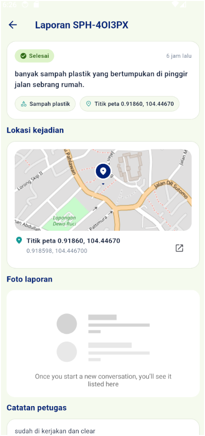 | ⚠️ |
| TC-35 | Detail laporan selesai & linimasa status | 1. Gulir ke bagian catatan dan linimasa *Riwayat status* | Menampilkan catatan penyelesaian, petugas, waktu, dan seluruh tahap sampai `Selesai` | Menampilkan catatan *"sudah di kerjakan dan clear"*, petugas `Andri Saputra`, waktu `11:26`, dan seluruh tahap status hingga `Selesai`. 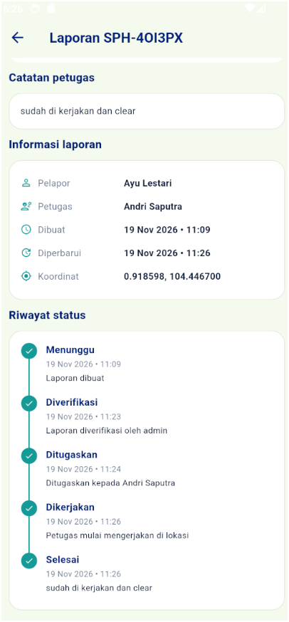 | ✅ |
| TC-36 | Profil & informasi akun Petugas DLH | 1. Buka tab *Profil* pada halaman Petugas DLH | Menampilkan informasi akun petugas, metrik tugas, status aktif, dan opsi keluar/reset demo | Menampilkan akun `Andri Saputra` (`petugas@sipahal.com`), metrik `2` total tugas & `1` selesai, status `Aktif`, dan opsi keluar/reset demo. Label penyimpanan tertulis `Lokal (demo)` (lihat BUG-02). 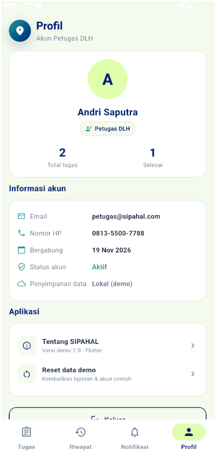 | ⚠️ |
| TC-37 | Notifikasi status Selesai pada pembaruan | 1. Buka daftar notifikasi pembaruan status | Menampilkan pembaruan status `Selesai` beserta catatan penyelesaian dan koordinat | Menampilkan pembaruan `Laporan SPH-4OI3PX · Selesai` (`23 pembaruan status`) dengan catatan penyelesaian dan koordinat. 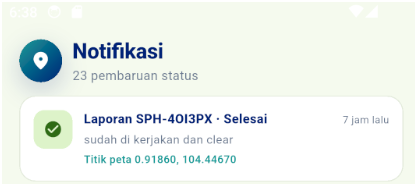 | ✅ |
| TC-38 | Detail laporan Selesai (tampilan atas) | 1. Buka detail laporan `SPH-4OI3PX` berstatus `Selesai` (bagian atas) | Menampilkan badge `Selesai`, peta lokasi, dan *Catatan petugas* | Detail `SPH-4OI3PX` menampilkan badge `Selesai`, peta lokasi, dan *Catatan petugas*. 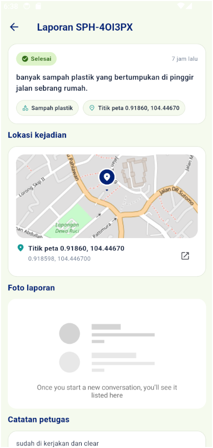 | ✅ |
| TC-39 | Detail laporan Selesai & riwayat lengkap | 1. Gulir ke bagian bawah detail laporan `SPH-4OI3PX` berstatus `Selesai` | Menampilkan catatan petugas, informasi pembaruan, dan linimasa status aktif sampai `Selesai` | Menampilkan catatan petugas, informasi pembaruan `19 Nov 2026 • 11:26`, dan linimasa status aktif sampai `Selesai`. 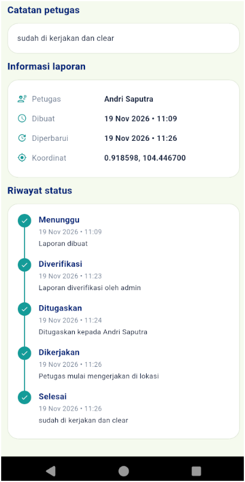 | ✅ |

### E. Monitoring Akhir & Skenario Penolakan Laporan

| ID | Judul | Langkah Pengujian | Hasil Diharapkan | Hasil Nyata | Status |
|----|-------|-------------------|------------------|-------------|--------|
| TC-40 | Monitoring laporan setelah selesai | 1. Buka *Monitoring Laporan* Admin setelah `SPH-4OI3PX` selesai | Menampilkan `SPH-4OI3PX` berstatus `Selesai` dan petugas yang menangani | *Monitoring Laporan* menampilkan `SPH-4OI3PX` dengan badge `Selesai` dan petugas `Andri Saputra`. 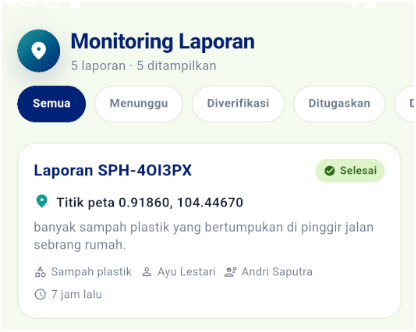 | ✅ |
| TC-41 | Detail laporan berstatus Ditolak (atas) | 1. Buka detail laporan `SPH-BAEGFV` yang ditolak Admin | Menampilkan badge `Ditolak`, peta lokasi, dan *Alasan penolakan* | Detail `SPH-BAEGFV` menampilkan badge `Ditolak`, peta lokasi, dan *Alasan penolakan* (`"ngasal"`). 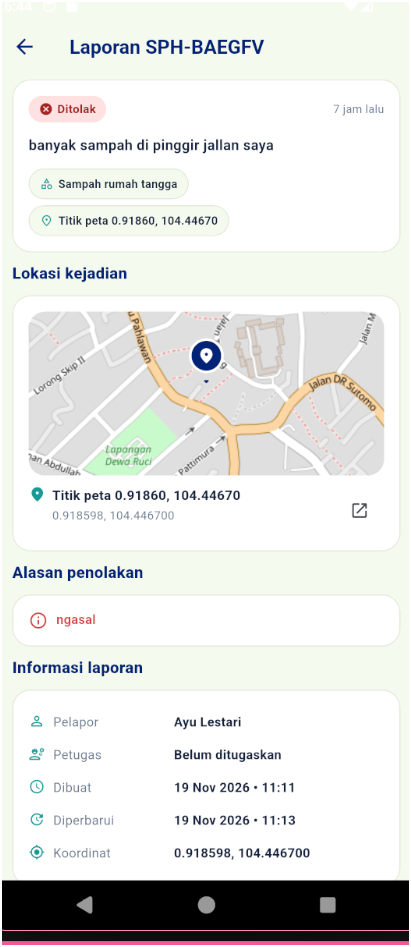 | ✅ |
| TC-42 | Informasi pelapor & riwayat status Ditolak | 1. Gulir ke bagian informasi laporan dan *Riwayat status* pada `SPH-BAEGFV` | Menampilkan pelapor, status petugas, waktu pembaruan, dan tahap `Ditolak` | Menampilkan pelapor `Ayu Lestari`, petugas `Belum ditugaskan`, waktu pembaruan, dan status `Ditolak`. 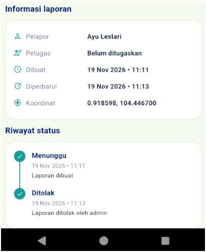 | ✅ |
| TC-43 | Ringkasan detail laporan Ditolak | 1. Periksa tampilan detail laporan `SPH-BAEGFV` berstatus `Ditolak` | Menampilkan status `Ditolak`, lokasi, alasan penolakan, dan blok informasi laporan | Menampilkan status `Ditolak`, lokasi, alasan `"ngasal"`, dan blok informasi laporan `SPH-BAEGFV`. 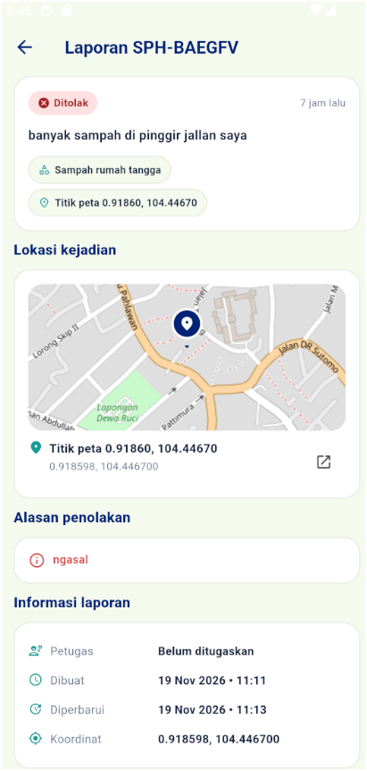 | ✅ |
| TC-44 | Linimasa riwayat penolakan laporan | 1. Periksa bagian alasan penolakan dan linimasa *Riwayat status* | Menampilkan alasan penolakan, waktu pembuatan/penolakan, dan tahap `Ditolak` | Menampilkan alasan penolakan `"ngasal"`, waktu `11:11`–`11:13`, dan tahap *Riwayat status* `Ditolak`. Terlihat potongan taskbar pada bagian bawah tangkapan layar (lihat BUG-03). 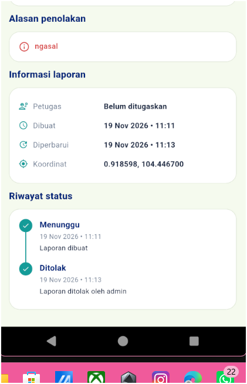 | ⚠️ |
| TC-45 | Alasan penolakan & status Ditolak oleh admin | 1. Periksa catatan pada *Riwayat status* laporan yang ditolak | Memperlihatkan catatan penolakan *"Laporan ditolak oleh admin"* | Memperlihatkan catatan penolakan *"Laporan ditolak oleh admin"* pada *Riwayat status*. 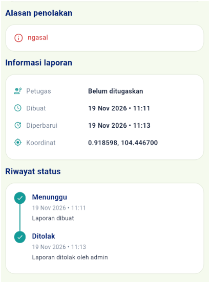 | ✅ |
| TC-46 | Daftar notifikasi rangkaian status | 1. Buka daftar *Notifikasi* (`23 pembaruan status`) | Menampilkan urutan pembaruan status laporan secara jelas | Menampilkan `23 pembaruan status` dengan urutan `Selesai`, `Dikerjakan`, `Ditugaskan`, dan `Diverifikasi`. 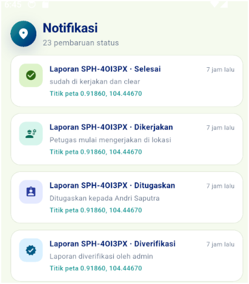 | ✅ |

## 7. Ringkasan Hasil & Daftar Bug

### Ringkasan Hasil

| Total | Pass | Pass dengan Catatan | Fail |
|-------|------|---------------------|------|
| 46    | 41   | 5                   | 0    |

### Daftar Bug yang Ditemukan

| ID Bug | Dari TC | Deskripsi | Tingkat (Rendah/Sedang/Tinggi) | Bukti |
|--------|---------|-----------|-------------------------------|-------|
| BUG-01 | TC-09, TC-34 | Masih muncul placeholder teks berbahasa Inggris (*"Once you start a new conversation, you'll see it listed here"*) pada area detail laporan / foto laporan. | Rendah | `evidence/09_detail_laporan_atas.png`, `evidence/34_petugas_detail_selesai_atas.png` |
| BUG-02 | TC-11, TC-25, TC-36 | Pada halaman profil pengguna masih tampil indikator penyimpanan *"Lokal (demo)"* saat pengujian berjalan. | Rendah-Sedang | `evidence/11_warga_profil_dan_info_akun.png`, `evidence/25_admin_profil_dan_pengaturan.png`, `evidence/36_petugas_profil_dan_info_akun.png` |
| BUG-03 | TC-44 | Salah satu screenshot skenario laporan ditolak masih menyertakan area taskbar sistem di bagian bawah tangkapan layar. | Rendah | `evidence/44_laporan_ditolak_riwayat_status.png` |